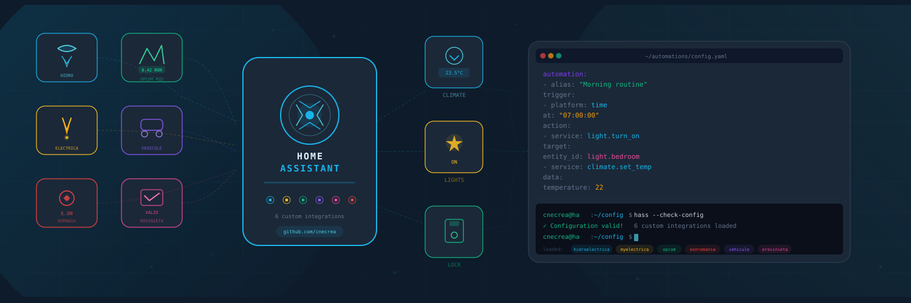

## Salut! 👋

Sunt **Ciprian Nicolae**, lucrez în securitate cibernetică și sunt pasionat de automatizări inteligente. Folosesc **Home Assistant** de 4 ani și mi-am făcut casa inteligentă pas cu pas.

În afara tastaturii, sunt un tip familist: am o relație frumoasă care mă ancorează, iubesc animalele și am o pisică de 6 ani pe nume **Miau**. E grasuță, leneșă, cu ochi mari și o expresie exact ca Garfield – dar e cea mai frumoasă și mai răsfățată 🐱

În timpul liber dezvolt **integrări personalizate** pentru Home Assistant, pornind de la nevoile reale pe care le-am întâlnit în propria casă. Prioritatea mea: **fiabil, eficient și ușor de folosit**.

---

<!-- DASHBOARD_START -->
## 📈 Statistici integrări

Ultima actualizare: 07.11.2026 16:47 (automat, zilnic)

| Integrare | Versiune | ⭐ Stars | 📥 Instalări | 👁 Vizitatori (14z) | 🔄 Clone (14z) |
|:----------|:--------:|:--------:|:------------:|:-------------------:|:--------------:|
| [Curs BNR](https://github.com/cnecrea/cursbnr) | `1.4.0` | 26 | 4.0k | 25 | 163 |
| [E-bloc România](https://github.com/cnecrea/e-bloc.ro) | `1.6.0` | 25 | 3.9k | 70 | 135 |
| [E.ON România](https://github.com/cnecrea/eonromania) | `4.1.6` | 55 | 5.9k | 52 | 204 |
| [~~CNAIR eRovinieta~~](https://github.com/cnecrea/erovinieta) | `2.10.3` | 41 | 4.0k | 0 | 0 |
| [CNAIR eToll](https://github.com/cnecrea/tollro) | `1.1.0` | 8 | 509 | 138 | 139 |
| [DIGI România](https://github.com/cnecrea/digi) | `1.0.0` | 1 | 382 | 47 | 166 |
| [Hidroelectrica](https://github.com/cnecrea/hidroelectrica) | `3.8.5` | 106 | 4.9k | 119 | 151 |
| [Manager de flotă](https://github.com/cnecrea/fleet) | `1.5.4` | 1 | 3.9k | 8 | 102 |
| [MyElectrica](https://github.com/cnecrea/myelectrica) | `2.9.4` | 24 | 4.9k | 46 | 169 |
| [MyENGIE](https://github.com/cnecrea/myengie) | `1.5.8` | 11 | 3.4k | 28 | 146 |
| [Nova Power & Gas](https://github.com/cnecrea/vreaulanova) | `2.0.0` | 2 | 4.9k | 12 | 143 |
| [OPCOM](https://github.com/cnecrea/opcom) | `2.2.4` | 8 | 4.4k | 38 | 120 |
| [Pago Plătește](https://github.com/cnecrea/pagoplateste) | `1.4.5` | 9 | 3.4k | 20 | 105 |
| [Rețele Electrice](https://github.com/cnecrea/reteleelectrice) | `1.1.7` | 8 | 3.1k | 71 | 109 |
| [SMS.to](https://github.com/cnecrea/smsto) | `2.0.2` | 4 | 3.4k | 21 | 124 |
| [Vehicule](https://github.com/cnecrea/vehicule) | `2.3.4` | 21 | 6.4k | 29 | 117 |
| [Vehicule Card](https://github.com/cnecrea/vehicule-card) | `1.3.0` | 7 | 2.7k | 0 | 0 |
| **TOTAL** | | **357** | **64.1k** | **724** | **2093** |

📈 Datele se actualizează zilnic prin GitHub Actions. Vizitatori/Clone = ultimele 14 zile (limită API GitHub). Toate integrările sunt disponibile prin <a href="https://hacs.xyz/">HACS</a> (Custom repositories).
<!-- DASHBOARD_END -->

---

## Contact și suport

📫 Pentru idei, întrebări sau colaborări: [Discuții pe GitHub](https://github.com/cnecrea/cnecrea/discussions)

Dacă folosești integrările mele și îți sunt utile, ia în considerare susținerea proiectului. Dezvoltarea lor consumă timp, resurse și multe ore de muncă, iar orice contribuție mă ajută să le mențin actuale și să adaug lucruri noi.

☕ [Buy Me a Coffee](https://www.buymeacoffee.com/cnecrea) 

Dacă vrei să ajuți direct, poți contribui prin testare beta, raportarea problemelor sau share temporar și anonim la conturi/servicii — mă ajută enorm să testez în condiții reale.
